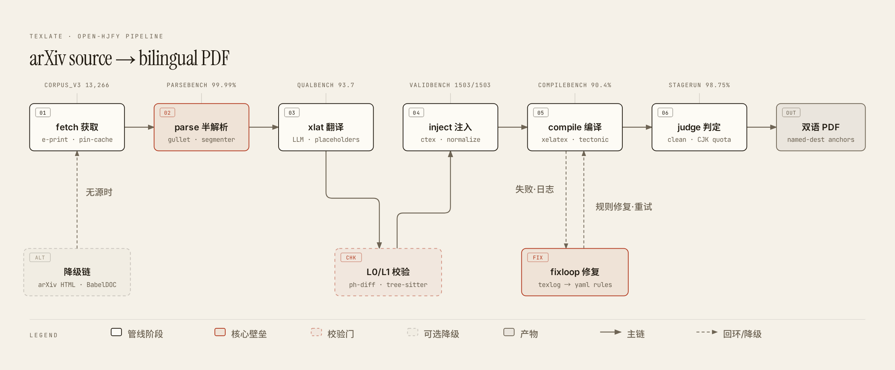

# TeXlate

[](https://github.com/WncFht/texlate/actions/workflows/ci.yml) [](https://pypi.org/project/texlate/) [](LICENSE)

TeXlate 是「幻觉翻译」的开源复现：获取 arXiv LaTeX 源码，只翻译段落文本，保护公式、引用与宏，再用中文排版环境重编译 PDF，供双语对照阅读。支持自带模型密钥（BYOK）、本地源码上传、PDF 侧车翻译、EPUB/DOCX 插译和译文共享。



## 安装与首次运行

需要 Python 3.12+；安装后再准备 tectonic 或带中文支持的 XeLaTeX：

```bash
uv tool install texlate
texlate tools install-tectonic
texlate doctor
texlate run 1706.03762
```

本地 `run` 使用占位译文验证链路，会获取源码并真实编译。真翻译由 Web 服务执行，先配置自己的模型端点与密钥：

```bash
export TEXLATE_BASE_URL="https://api.example.com/v1"
export TEXLATE_API_KEY="your-api-key"
export TEXLATE_MODEL="your-model"
texlate web
```

浏览器打开 `http://127.0.0.1:8765` 提交论文，也可用 `texlate run 1706.03762 --server http://127.0.0.1:8765`。发布 wheel 包含前端；源码安装先 `uv sync`，命令加 `uv run`，需要图形界面时执行 `bash scripts/build-web.sh`。

任务按块保存翻译进度；失败、取消或服务重启后可重试。完整交付、降级交付和失败分别显示，产物可能包括中文 PDF、原文重编译 PDF、译后源码、对齐数据、文献表和日志。没有原始 TeX 的降级通道不提供源码级复制保证。

## 阅读与扩展

双语阅读器提供滚动同步、句级高亮、引用卡片、文献翻译队列、源码复制和 PDF 主题。其定位能力受源标记和 PDF 结构限制。共享包可复用已翻译内容；导入方校验后本地重建。Zotero 7 插件把服务产出的中文 PDF 回挂到文献条目，见[插件说明](zotero/README.md)。

Docker 镜像包含前端、tectonic 和中文字体；BabelDOC 侧车独立安装，不随镜像分发：

```bash
docker run -p 8765:8765 -v texlate-data:/data ghcr.io/wncfht/texlate:latest
```

本地模式仅用于本机。对外服务使用 `TEXLATE_MODE=server` 并按[部署指南](docs/guide/web.md)配置认证、来源白名单、配额与保留期。TeX 源码、上传文件和远端模型均有独立的安全与资源边界。

## 文档与验证依据

[文档入口](docs/README.md)统一提供使用指南、当前契约、开发操作和历史实验证据。先读[快速开始](docs/guide/quickstart.md)，模型配置见[渠道与密钥](docs/guide/byok.md)，命令查 `texlate --help` 或[CLI 指南](docs/guide/cli.md)。

历史端到端样本中，通用留出集交付 171/200，CS 留出集 191/200，CS 放大样本 725/800；这些样本有交集，不能直接相加。交付率不等于无版面缺陷率，修复救回率需单列分母。详见[评测报告](docs/research/2026-10-16-端到端评测.md)。同十篇同模型对照的管线新输入为 agent 直翻的约 23%，样本、账本和质量限制见[token 实测](docs/research/methods/token-economy-2026-10-03/README.md)。这些是历史记录，未代表当前 HEAD 重新验收。

开发环境、检查命令与贡献要求见[贡献指南](CONTRIBUTING.md)。产品代码在 `src/texlate/`，阅读器在 `web/`，评测机制在 `bench/`；评测载荷、运行档案和付费字节保存在仓外。决策理由由 [Agent Notes](.agents/notes/README.md)维护。

## 许可与致谢

主项目使用 Apache-2.0，第三方宏包、替身与维护材料分别保留原许可，见 [LICENSE](LICENSE)、[NOTICE](NOTICE)与[维护材料来源](.agents/来源与取舍.md)。产品设计参考「幻觉翻译」，实现模式参考 ieeA，源码与公式解析仍需独立验证。
