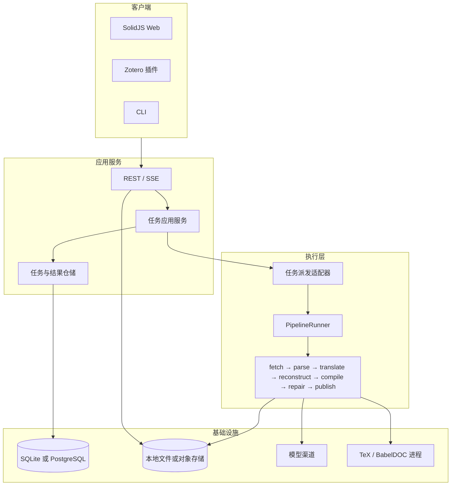

# 前后端与执行架构审计

## 目的与范围

这份审计为 TeXlate 的大规模重构提供代码依据。读者需要判断前端、HTTP 服务、执行管线和持久化是否应重新划界，以及是否值得更换技术栈。审计覆盖工作树中的 `src/texlate/`、`web/src/`、`zotero/src/`、现有规格与长期决策记录；工作树包含未提交变更。它不把静态文件数量当作性能或质量指标，也不把外部文档中的能力当作项目已经具备的能力。

重算入口是 [`audit.py`](evidence/frontend-backend-architecture/audit.py)。脚本统计源文件和行数，计算纳入路径的 SHA-256，装配 FastAPI 应用但不启动 worker，读取实际生成的 OpenAPI。JSON 结果见 [`baseline.json`](evidence/frontend-backend-architecture/baseline.json)。

## 代码事实

当前系统已经具备前后端结构，但后端不是单一“翻译接口”。它包含应用入口、HTTP 路由、鉴权和 BYOK、SQLite store、事件总线、内存任务调度、pipeline worker、文件产物和阅读器辅助数据。Web 是 SolidJS SPA，维护任务列表与实时状态、上传、阅读器、引用、收藏和设置。Zotero 与 CLI 是另外两个服务客户端。

产品 pipeline 的共用脊在 `pipecore/`：解析扫描、块状态转换、翻译树写回、编译判定和修复策略由 e2e、worker 和评测消费。`server/worker/` 仍负责工作目录、数据库断点、事件投影、状态迁移、取消和产物发布。CLI 的 `e2e.py` 和 worker 的 `_Core` 分别编排阶段链，说明“共同步骤”已经抽出，“一次运行的应用编排”还没有收敛到一个独立端口。

一次 Web 任务的现行路径是：POST 创建或上传任务；服务端解析输入、决定模型/凭据、计算幂等与缓存键、写入任务后入队；worker 执行获取、解析、翻译、重建、编译和修复；状态写 SQLite，事件写 `task_events` 并经 `EventBus` 扇出；浏览器对活动任务开 SSE，连接受限时轮询任务列表或快照；完成后浏览器读取文件清单、reader 数据和 `dual.json`，再加载 PDF/HTML。段落正文由另一路 chunks 轮询读取。

当前任务表把用户意图、一次运行、重试后的新运行和最新状态放在同一行。`task_events` 既承载业务阶段，也承载日志和修复实况。`files` 登记产物，但阅读器还要依赖 `dual.json`、任务 kind 和文件存在性来推导能力。前端因此在 [`tasks.ts`](../../web/src/stores/tasks.ts) 和 [`taskTransport.ts`](../../web/src/stores/taskTransport.ts) 维护水位线、SSE 槽、轮询降级、终态收敛和 retry 复活。

现行 OpenAPI 有 36 个操作，但实际装配结果没有请求体声明，成功响应通常是空 schema；前端的 [`rest.ts`](../../web/src/api/rest.ts)、Zotero 的 [`client.ts`](../../zotero/src/modules/client.ts) 和 `contracts.ts` 各自维护类型。这个事实是接口重构的直接依据：客户端生成必须先于 API 统一，但 API schema 不能从现有 OpenAPI 直接生成。

## 方案判断

推荐的长期结构是“多客户端 + 一个应用服务 + 一个独立 pipeline + 可替换基础设施”，而不是把 Web 和翻译器直接连起来：

pipeline 应当是 Python 中不依赖 FastAPI、Starlette、SQLite、浏览器和 CLI 的应用核心。它接收不可变的 `InputSnapshot` 与 `RunConfig`，通过 `PipelineRunner.run()` 返回 `RunResult`，通过 `ProgressSink` 发出结构化阶段和块事件，通过 `CancellationToken` 检查取消。服务、CLI 和评测只负责装配适配器。当前 `pipecore` 继续作为策略和算法层；`server/worker` 的阶段副作用应逐步移到应用 orchestration 与 storage ports。

首选保留 Python 3.12+、FastAPI、Typer、SolidJS、PDF.js/pdfslick 和现有文档/TeX 生态。全量换 Node、Go 或 Rust 会重写半解析 LaTeX、占位符重建、翻译批处理、编译修复、安全解包和 Office/PDF 适配，当前没有等价性、性能或维护成本证据支持。前端保留 SolidJS 的局部高频状态和已有 PDF 适配器；引入 Solid Router 与 Solid adapter for TanStack Query 统一路由和服务器状态缓存，删除自有任务状态复制层，而不是用新框架复刻旧状态机。

数据库默认仍是 SQLite WAL，因为本地安装和单用户服务是明确的产品形态。任务创建和派发必须先建立仓储/队列端口，并把 enqueue 意图与任务写入同一事务可恢复记录；不能继续把任务写入 SQLite 后仅把真实队列项放在进程内存。需要多 worker、多节点或更高并发时，增加 PostgreSQL + Procrastinate 适配器。Procrastinate 的 PostgreSQL 队列支持用外部连接把任务插入与业务写入放在一个事务，也有心跳、停滞 job 重试和取消语义；这些能力适合成为基础设施适配器，不应渗入任务领域模型。SQLite 只能继续作为本地模式，不能承诺多副本共享调度。

暂不把 Temporal 作为默认执行引擎。Temporal 的 durable workflow 和 activity retry 可解决更长时间的崩溃恢复，但同时要求 workflow 确定性、历史兼容和额外服务运维。应先用 attempt、lease、阶段哨兵和可重入活动解决当前问题；只有真实故障数据表明这些机制不足，且接受新增服务后，才做独立 Temporal 原型。

## 目标接口

API 以资源和能力表达事实，不能让前端通过任务 kind、文件名和错误字符串推导行为。建议使用 `/api/v1` 新命名空间，与现有 `/api` 并行迁移：

| 资源                                 | 作用                                                        |
| ------------------------------------ | ----------------------------------------------------------- |
| `POST /tasks`                        | 创建 arXiv、上传或共享包任务；请求使用 discriminator 联合体 |
| `GET /tasks`                         | 分页任务摘要，返回 `next_cursor` 和资源版本                 |
| `GET /tasks/{task_id}`               | 任务意图、当前 attempt、可用结果与能力                      |
| `POST /tasks/{task_id}/attempts`     | 创建新 attempt；参数覆盖必须参与幂等指纹                    |
| `GET /attempts/{attempt_id}`         | attempt 状态、阶段进度、错误和统计                          |
| `POST /attempts/{attempt_id}:cancel` | 请求取消，返回取消请求状态                                  |
| `GET /attempts/{attempt_id}/events`  | SSE；`after`/`Last-Event-ID` 是 attempt 内游标              |
| `GET /tasks/{task_id}/artifacts`     | 不可变产物版本、摘要、媒体类型和授权 URL                    |
| `GET /tasks/{task_id}/reader`        | 阅读文档、对齐、数据 URL 和 capabilities                    |
| `GET /attempts/{attempt_id}/chunks`  | 页码/游标/seq 定点读取，正文不进入事件流                    |

每个 JSON 请求和响应必须有 Pydantic 模型；错误统一为带稳定 `code`、`message`、`request_id` 和可选字段的 envelope。响应中区分 `status`、`availability` 和 `capabilities`。事件统一带 `schema_version`、`event_id`、`task_id`、`attempt_id`、`attempt_seq`、`type`、`occurred_at` 和类型化 `data`。重试创建新 attempt；task URL 不变，旧 attempt 仍可读，避免上一轮 `done` 关闭新一轮 SSE。

输入源、任务配置、凭据引用、幂等指纹和产物版本都必须明确所有权。`X-Texlate-Key` 目前同时被用于模型渠道和 server 租户身份；远程多用户模式应引入应用会话（同源 Cookie 或明确的客户端令牌），模型凭据只进入 attempt 执行上下文。应用会话必须同时覆盖 REST、SSE 和文件授权，并配套 CSRF/Origin 策略；不能依赖原生 `EventSource` 自动携带自定义模型头。

## 重构顺序

第一阶段只建立契约和基准，不修改管线算法：Pydantic schema、OpenAPI 快照、生成 TypeScript 类型、错误和分页模型；补充现有 CLI、Zotero、Web 的 contract tests。并行固定一组源文件、块结果、PDF/HTML 产物和错误状态作为 pipeline benchmark，运行 mock、真实模型和编译环境三类条件。

第二阶段建立 `TaskApplication`、`PipelineRunner`、`ArtifactRepository`、`EventPublisher`、`JobDispatcher` 端口。让现有 Store、EventBus、TaskRunner 和工作目录成为适配器，先保留旧路由和旧数据库列。此阶段验证 HTTP、CLI、bench 调用同一 pipeline runner，并测量事件延迟、任务恢复、CPU/内存、磁盘占用和模型调用成本。

第三阶段引入 attempt 和 artifact 投影。旧 `task_id`、旧 `/api` 和既有缓存/share 格式进入兼容适配层，所有新增行为使用 `/api/v1`。重试、取消、幂等、事件重放、worker 崩溃和单段重译以状态机测试覆盖。

第四阶段重写 Web 数据层：Solid Router 负责路由，TanStack Query 负责快照、分页、失效和 mutation；一个用户级事件流只触发有限查询失效。阅读器继续使用现有 PDF/HTML pane、对齐、导航、引用和主题 controller。通过真实浏览器测试证明刷新、断线、多标签、旧 attempt 与 partial artifact。

第五阶段按部署证据选择 PostgreSQL/Procrastinate 或继续 SQLite，并决定本地文件与对象存储的边界。只有新适配器完成恢复、租户、并发认领、备份恢复和产物授权测试，才删除旧路由、旧表投影和客户端兼容代码。

## 证据与限制

代码统计和 OpenAPI 快照只描述 2026-10-18 的工作树，不代表已发布版本。未进行真实模型、TeX 编译或多节点性能基准；因此本报告不承诺 PostgreSQL、对象存储或 Temporal 的收益。外部技术资料只用于核对能力边界：FastAPI 支持从响应模型生成 OpenAPI 和客户端；openapi-typescript/openapi-fetch 可从有业务 schema 的 OpenAPI 生成 TypeScript 类型；TanStack 的 Solid adapter 专门处理服务器状态缓存与同步；PostgreSQL 行锁可实现队列认领；Procrastinate 文档说明事务性 enqueue、worker heartbeat、停滞重试和取消；Temporal 文档强调 activity 幂等和 workflow 确定性。具体链接见参考文献。

### 参考文献
