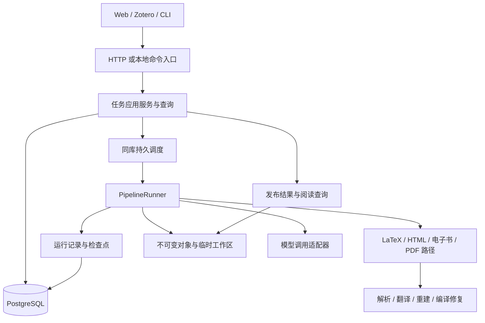

# 应用服务与执行层设计提案

## 推荐结论与适用目标

建议重写任务应用服务、运行编排、持久化模型和客户端数据层，保留并逐步整理解包、LaTeX 解析、占位符校验、翻译批处理、编译和修复算法。目标结构是 Python 模块化单体：API 与 worker 分进程，复用同一个应用包；一套服务数据库，一套运行状态机，一套结果发布协议。这里的“单体”指业务代码与发布版本统一，不要求把 HTTP、模型请求和编译进程放在一个进程中。

服务部署首选 PostgreSQL、SQLAlchemy、Alembic 和 Procrastinate；HTTP 保留 FastAPI 与 Pydantic，客户端保留 SolidJS、PDF.js 和 Typer。选择 PostgreSQL 的依据是把任务事务、持久调度和多进程读写收敛到一个数据库，尚无基准证明它能提高当前系统的吞吐量。

这项选择有明确的产品代价：新 Web 服务需要 PostgreSQL，不能同时承诺当前 `uvx texlate web` 无外部数据库的安装体验。独立 CLI 可以继续直接运行同一个 pipeline，使用文件检查点。若无外部服务的本地 Web 仍是首要产品要求，应把整个服务方案改为 SQLite 单机方案，并接受单机调度边界；不建议第一版同时开发两套完整服务后端。已有本地服务的数据和发布承诺仍需迁移支持，本文没有批准删除它们。

核心领域概念是源版本 `SourceVersion`、翻译任务 `Task`、运行 `Run` 和发布结果 `Release`。数据库另有解析快照、段落、译文及调用记录，但不为每张表创建领域服务，也不为每个函数创建接口。

## 代码依据与核验范围

以下判断基于 2026-10-18 的工作树，包含已有未提交修改。当前契约入口是[架构](../spec/architecture.md)与[服务端规格](../spec/server.md)。本文描述拟议架构，不改变当前运行行为。

| 当前实现                                                                  | 代码依据                                                                                                                          | 设计含义                                     |
| ------------------------------------------------------------------------- | --------------------------------------------------------------------------------------------------------------------------------- | -------------------------------------------- |
| 一个任务行同时保存用户输入、执行状态、工作进程、计数器与错误              | [`store/_common.py`](../../src/texlate/server/store/_common.py) 的 `DDL`                                                          | 任务身份与运行身份应分开                     |
| retry 将原行迁回 queued，按主文件或引擎变化删除 chunks、工作树和文件登记  | [`routers/tasks.py`](../../src/texlate/server/routers/tasks.py) 的 `task_retry`                                                   | 旧结果与下一轮执行不应共享可变目录           |
| 单块重译保持任务终态，依次改源码、chunks、PDF、dual；重编失败可保留旧 PDF | [`worker/retranslate.py`](../../src/texlate/server/worker/retranslate.py) 的 `_retranslate_one`                                   | “一组可读结果”需要统一版本和发布点           |
| files 按 task、kind 覆盖登记                                              | [`store/_files.py`](../../src/texlate/server/store/_files.py) 的 `put_file`                                                       | 文件摘要不能独自表达一组文件之间的版本一致性 |
| worker 用内存队列与单消费者；启动回放 queued，凭据随内存丢失              | [`worker/runner.py`](../../src/texlate/server/worker/runner.py) 的 `TaskRunner`                                                   | 调度恢复与凭据恢复是两个独立问题             |
| worker 上下文持有 Store、EventBus、任务行、目录及各阶段内存状态           | [`worker/_common/ctx.py`](../../src/texlate/server/worker/_common/ctx.py) 的 `TaskCtx`                                            | 算法输入和运行基础设施需拆开                 |
| CLI 与 worker 共享策略，但仍分别驱动全链                                  | [`e2e.py`](../../src/texlate/e2e.py) 的 `pipeline_run`、[`worker/core.py`](../../src/texlate/server/worker/core.py) 的 `_run_tex` | 需要统一应用编排，继续复用 `pipecore`        |
| 任务状态和 done 事件分别提交，事件还承担日志与重放                        | [`worker/emit.py`](../../src/texlate/server/worker/emit.py)、[`events.py`](../../src/texlate/server/events.py)                    | 状态变更与变更通知应有共同事务               |
| 前端处理每任务 SSE 槽、终态复活、轮询、富字段继承与水位                   | [`taskTransport.ts`](../../web/src/stores/taskTransport.ts)、[`tasks.ts`](../../web/src/stores/tasks.ts)                          | 服务器资源版本应替代客户端对运行历史的推断   |

相关现行测试包括 [`test_retranslate.py`](../../tests/server/test_retranslate.py)、[`test_server_store.py`](../../tests/server/test_server_store.py) 和 [`test_worker_cancel_protocol.py`](../../tests/server/test_worker_cancel_protocol.py)。它们记录当前保留旧译文、状态重试和取消收尾等行为，不能作为新架构已经实现的证据。

## 责任与粒度

### 三个业务模块与独立适配器



业务代码按三个模块组织：

- `tasks`：用户意图、创建运行、取消请求、权限、幂等、运行结果发布。应用服务在这里确定业务事务。
- `execution`：运行计划、各格式 pipeline、检查点、段落结果选择、修复循环和交付判定。负责“怎样完成运行”。
- `reading`：发布结果查询、阅读能力、阅读位置和收藏。消费已发布结果，不读取 worker 的临时目录。

数据库、队列、模型传输、对象存储和子进程管理作为适配器放在业务模块外。先保持一个 Python 包和一个发行物；格式实现可以按文件拆分，不需要拆成服务。HTTP 端点不得直接调用 worker 私有方法，也不得负责删除解析目录。

不引入通用命令总线、自动事件处理链、每表一个 Repository 基类或配置驱动工作流语言。应用方法按真实用户用例命名，例如 `submit_task`、`start_run`、`request_cancel`、`publish_release`；查询直接返回类型化读模型。SQLAlchemy Session 作为应用事务工具即可，不必再包一层只有 begin/commit 的通用工作单元。

### 四个领域对象

| 对象            | 表达的事实                                       | 可变边界                                 |
| --------------- | ------------------------------------------------ | ---------------------------------------- |
| `SourceVersion` | 一份已获取、校验并固定字节的输入及来源信息       | 内容不可变；留存和损坏状态单独记录       |
| `Task`          | 某用户对某输入的翻译意图、目标语言及稳定访问入口 | 标题、收藏等管理信息和已发布结果指针可变 |
| `Run`           | 用一份固定配置完成一次初译、修订或重新构建       | 生命周期、检查点和发布前的工作进度可变   |
| `Release`       | 一组属于同一内容版本的译文、文件、对齐和质量说明 | 发布后内容不可变；可用性随保留策略变化   |

源版本解决“具体处理了什么”，Task 解决“用户在做哪件事”，Run 解决“哪次操作怎样执行”，Release 解决“用户现在读到哪一版”。Task 不再维护第二套执行状态机；任务列表的当前状态由最新 Run 投影得到。

未钉版 arXiv 请求在提交时只有 locator。首次获取后将 Task 的 `source_version_id` 从空绑定到确定版本，绑定和检查点在同一事务内提交，此后只读。恢复继续读取已保存字节。主动跟随新版论文创建新 Task；不能让 retry 悄然把 v1 换成 v2。下载前可以重试网络读取；字节已经进入付费翻译后，禁止重新解析 `latest` 替换输入。

不在第一版引入独立 `Paper`、`Project`、`Workspace`、`Document` 层级。当前翻译与阅读需求可由 Task 和 SourceVersion 表达；未来若引入跨版本论文库，再建立有真实消费者的书目实体。

### Run 与队列投递分开

用户点击重新执行，创建新 Run。worker 崩溃后对同一配置的自动恢复，仍属于原 Run，由队列重投递；记录新的执行代号 `execution_generation`。用户修订某段时，创建 `operation=revise` 的 Run，带 `base_release_id` 和目标段落，成功后产生新 Release。

因此不同时建立含义重叠的 Run、业务 Attempt、Job 和 StageTask 四层领域对象。Procrastinate 的 job ID 和投递次数只属于调度适配器。Run 的配置、输入和基准结果保持不变；修改模型或引擎需要新 Run，修改输入或目标语言需要新 Task。

第一版每个 Task 最多一个非终态 Run。创建时锁定 Task，并用部分唯一索引兜底。这个约束简化取消、结果选择和阅读器的“当前操作”；将来要同时比较多个模型时，再显式开放分支与发布选择。

## 执行层设计

### 一次 Run 一个持久作业，阶段内部并发

队列先只暴露 `execute_run(run_id)` 一个产品执行入口；维护清理和停滞恢复可以有各自作业。不要把每个段落、每轮模型重试和每次 TeX 编译做成持久队列任务。现有 [`xlat/pipeline/orch.py`](../../src/texlate/xlat/pipeline/orch.py) 已支持 batch、single、split 和块级并发，拆成独立作业会增加顺序、上下文、计费与恢复协调。

持久检查点以可独立验证和复用的中间结果为单位：获取结果、解析快照、段落翻译结果、渲染输入清单、最终候选结果。函数拆分以领域语义为单位。只有当一个阶段需要独立扩容、独立重试预算或跨主机数据交接时，才考虑把它提升为作业。

LaTeX 路径可以保持直接的 Python 控制流：

```text
acquire → prepare/parse → translate → assemble → compile/repair → publish
```

`compile/repair` 包含现有 precheck、logfix、fixloop 的先后关系，不为每轮恢复另造通用 DAG。HTML 和电子书复用翻译会话及段落契约，各自负责回插和导出。PDF 路径封装 BabelDOC 子进程；它不支持的段落定位和修订能力不应由基类伪造。

### 有类型的输入输出与少量端口

用以下形态代替持续扩大的 TaskCtx 和 mixin 组合根，名称为拟议接口：

```text
PipelineRunner.execute(RunSpec, RunRuntime) -> RunOutcome

RunSpec:
  run_id, source_ref, operation, base_release_ref
  resolved_config, implementation_versions

RunRuntime:
  journal, objects, model_gateway, process_runner, cancellation

prepare(SourceRef, ParseConfig) -> ParsedDocument
translate(ParsedDocument, TranslationSession) -> TranslationSelection
render(ParsedDocument, TranslationSelection, RenderConfig) -> CandidateRelease
```

Pydantic 负责 HTTP、队列消息和持久 JSON 的验证与版本；内部算法对象优先使用 dataclass、明确的联合类型和既有领域类型。ORM 模型表达数据库关系，不直接作为 API 响应。三者按边界分工，不为每个字段机械创建三份相同类。

`RunRuntime` 提供资源句柄，阶段特有数据由返回值传递。`ParsedDocument` 包含结构和定位，不含 Session；`TranslationSelection` 指向确定的段落结果集合；`CandidateRelease` 声明文件、内容摘要和质量。原始路径只存在于工作区适配器，不进入客户端协议。

第一版只为有真实边界的能力定义端口：运行记录 `RunJournal`、对象与工作区 `ObjectStore`、模型调用 `ModelGateway`、子进程 `ProcessRunner`。取消检查是一个小协议。应用服务直接依赖具体 SQLAlchemy 查询模块，不要求把每个 SQL 查询藏进抽象仓储。

`RunJournal` 的关键操作是原子记录一批段落结果、保存检查点、提交运行结果；它有持久化保证和执行代号校验。`ProgressSink` 仅做展示更新，不能承担保存付费译文的责任。CLI、服务和 bench 装配相同 Runner；CLI 文件 journal 与服务数据库 journal 复用相同检查点 schema。性能微基准可以直接调用算法，产品端到端基准必须经过 Runner。

### 资源与进程边界

API 进程不启动翻译 worker。初期一个 worker 进程允许少量并发 Run，每个 Run 内保持模型请求并发；TeX 和 BabelDOC 使用受限、可终止的子进程组，CPU 密集的解析在需要可强制停止时也走独立进程。线程取消不能终止线程，不能用协程已取消证明目录已停止写入。

运行槽、模型请求额度与编译资源额度分别限制。第一版可把渠道额度集中在一个翻译 worker 内，不立即承诺多 worker 共享进程内 semaphore。增加 worker 时，必须静态分配总额度或引入真正跨进程的额度协调；仅将同一个数写入每个进程会放大限额。

本地文件适配器可服务第一版，但 API 和 worker 必须能访问同一持久对象根。跨节点部署需要对象存储或共享存储。临时工作区不跨节点共享；恢复从对象与检查点重建，不依赖死亡进程留下的某个本机目录。

## 数据库模型

### 表的职责和主要字段

以下是逻辑模型，不是已验证可直接部署的迁移脚本。主键采用应用生成的 UUID，排序使用显式 ordinal 或版本号；所有用户数据关系带 `tenant_id`。时间使用 PostgreSQL `timestamptz`，计数用整数，金额若落库用定点数和币种。状态可用 `text + CHECK`，减少频繁更改 PostgreSQL enum 的迁移成本。

| 表                                | 主要字段                                                                                                                                                                                                                                                           | 约束与关系                                                               |
| --------------------------------- | ------------------------------------------------------------------------------------------------------------------------------------------------------------------------------------------------------------------------------------------------------------------ | ------------------------------------------------------------------------ |
| `tenants`                         | `id, name, created_at`                                                                                                                                                                                                                                             | 本地或单用户部署可只有一行；不以模型 key 派生身份                        |
| `objects`                         | `tenant_id, id, storage_key, sha256, bytes, media_type, availability`                                                                                                                                                                                              | `(tenant_id, sha256)` 唯一；用户对象均经所有者授权                       |
| `source_versions`                 | `tenant_id, id, format, locator_json, resolved_version, raw_object_id, source_manifest_object_id, content_digest`                                                                                                                                                  | 已固定输入不可改；同租户按格式和内容摘要去重                             |
| `tasks`                           | `tenant_id, id, input_spec_json, source_version_id?, target_lang, title, published_release_id?, version, deleted_at?`                                                                                                                                              | `source_version_id` 最多绑定一次；稳定用户入口                           |
| `runs`                            | `tenant_id, id, task_id, ordinal, operation, base_release_id?, status, phase, config_schema_version, config_json, config_digest, pipeline_version, parse_snapshot_id?, execution_generation, cancel_requested_at?, version, error_json, started_at?, finished_at?` | `(tenant_id, task_id, ordinal)` 唯一；每 Task 最多一个非终态 Run         |
| `parse_snapshots`                 | `tenant_id, id, source_version_id, parse_key, parser_version, normalized_tree_object_id, structure_object_id`                                                                                                                                                      | `parse_key` 唯一于租户；快照完成后不可改                                 |
| `segments`                        | `tenant_id, parse_snapshot_id, id, ordinal, kind, locator_json, source_text, masked_text, source_digest`                                                                                                                                                           | `(tenant_id, parse_snapshot_id, id)` 主键，ordinal 同快照内唯一          |
| `segment_results`                 | `tenant_id, id, parse_snapshot_id, segment_id, produced_by_run_id, translation_key, outcome, text, validation_json, invocation_id?, supersedes_id?`                                                                                                                | 追加记录；保留被替换与被拒绝译文，不用缓存覆盖唯一付费结果               |
| `run_segments`                    | `tenant_id, run_id, parse_snapshot_id, segment_id, selected_result_id?, state, error_json`                                                                                                                                                                         | 每个 Run 对每个段落的当前选择；结果必须属于同一解析快照和段落            |
| `run_checkpoints`                 | `tenant_id, run_id, step, input_digest, output_object_id, producer_version, completed_at`                                                                                                                                                                          | `(tenant_id, run_id, step, input_digest)` 唯一；只保存完成且验证过的输出 |
| `releases`                        | `tenant_id, id, task_id, run_id, parse_snapshot_id?, selection_object_id?, manifest_object_id, content_digest, quality_json, created_at`                                                                                                                           | 每 Run 最多一个发布结果；引用文件和译文集合都固定                        |
| `artifacts`                       | `tenant_id, release_id, role, object_id, derived_from_digest`                                                                                                                                                                                                      | 同 Release 的 role 唯一；文件属于结果，不属于可变 task 目录              |
| `model_invocations`               | `tenant_id, id, run_id, purpose, provider_id, credential_ref?, wire_model, request_digest, status, provider_request_id?, usage_json, started_at, finished_at?`                                                                                                     | 一行对应一次实际模型请求；允许结果未知、usage 未知                       |
| `credentials` / `run_credentials` | 所有者、凭据引用、加密载荷或外部 secret 引用、到期时间、Run 绑定                                                                                                                                                                                                   | 密钥与业务配置分离；更新绑定不改已固定的模型语义                         |
| `api_idempotency`                 | `tenant_id, operation, key, request_digest, response_json, expires_at`                                                                                                                                                                                             | `(tenant_id, operation, key)` 唯一；不同请求体重用同键返回冲突           |
| `change_events`                   | `tenant_id, stream_seq, resource_type, resource_id, resource_version, type, data_json, created_at`                                                                                                                                                                 | `(tenant_id, stream_seq)` 主键；与对应业务变更同事务写入                 |
| `reader_positions` / `kept_refs`  | 用户或租户、Task、Release、稳定引用及位置/收藏快照                                                                                                                                                                                                                 | 独立于临时工作区；跨 Release 迁移定位须验证                              |

Procrastinate 自有表由它管理迁移，业务代码不直接更新其状态列。渠道配置转入 `providers`、`provider_models` 和 `routing_policies`：分别保存端点与协议、上游模型名与能力、路由优先级与允许回退集合。凭据单独保存引用及所有者，不塞入 config JSON。现有渠道文件作为迁移输入，不能在新服务中继续与数据库双向写入。

SQLAlchemy 采用显式查询和关系，限制隐式 lazy load；不把任务、所有段落和所有历史 Run 一次加载成大对象树。Task 只负责序号分配、活动 Run 约束和发布指针等小范围不变量，段落批量结果使用专用事务写入。

### 必须落到数据库的约束

跨租户、跨任务或跨段落串联不能只靠路由检查。对被引用实体建立所需的联合唯一键，外键包含 `tenant_id`；Release 的 Run 关系还包含 `task_id`。`tasks.published_release_id` 必须指向同一 Task 的 Release，`run_segments.selected_result_id` 必须指向同一解析快照和段落的结果。Task 与 Release 的循环外键可在建表后用迁移添加，事务中先插 Release 再更新 Task。

关键索引的形态如下，完整 DDL 还需补齐表定义、外键和迁移验证：

```sql
CREATE UNIQUE INDEX uq_runs_active
ON runs (tenant_id, task_id)
WHERE status IN ('queued', 'running', 'waiting_auth');

CREATE UNIQUE INDEX uq_runs_ordinal
ON runs (tenant_id, task_id, ordinal);

CREATE UNIQUE INDEX uq_api_idempotency
ON api_idempotency (tenant_id, operation, key);

CREATE INDEX ix_tasks_listing
ON tasks (tenant_id, created_at DESC, id DESC)
WHERE deleted_at IS NULL;

CREATE INDEX ix_runs_listing
ON runs (tenant_id, task_id, ordinal DESC);

CREATE INDEX ix_segment_results_reuse
ON segment_results (tenant_id, translation_key)
WHERE outcome = 'translated';
```

创建 Run 时锁 Task，检查版本和权限，分配 ordinal，写 Run、幂等回执、变更事件与队列 job，再一起提交。发布时锁 Task 和 Run，验证取消状态、执行代号、基准 Release 和完整清单，再更新发布指针。所有跨行写入遵守一致的锁顺序；并发冲突按业务动作返回可重试错误。

源内容、已发布 Release、被引用译文结果的不可变性需要数据库权限或触发器补强；CHECK 无法禁止对已有行的任意修改。留存、对象 availability 和用户管理信息保持可更新。删除以显式软删除和后续清理开始，不把 Task 删除直接级联成跨任务共享对象的物理删除。

### JSON 与对象存储的边界

需要授权、关联、排序、去重和筛选的字段使用列。可变长度且随 schema 演进的运行策略、质量说明、定位联合类型、manifest 和诊断可使用版本化 JSONB。大体积解析结构、占位符映射、源码树、PDF、HTML 和对齐数据进入对象存储。段落正文留在数据库以支持分页查询，未来按实际体积测量调整。

不要把所有状态藏在 `options_json`。区分用户请求 `RequestedConfig`、运行实际配置 `ResolvedConfig` 与外部观测 `ObservedExecution`。默认值在创建 Run 时解析一次；worker 不再从当前 settings 重新补全历史参数。非确定的自动术语抽取结果在付费调用后立即保存，后续步骤读取该内容摘要。

`ResolvedConfig` 记录模型策略、允许回退的候选集合、术语与提示词版本、引擎和修复预算；每次调用另记实际渠道与上游模型名。凭据可以更新，已固定的端点和模型语义不能随渠道文件更新悄然变化。上游模型别名可变，因此这里保证可审计输入，不承诺真实模型输出逐字可复现。

### 三种复用语义

请求幂等、避免重复执行和结果缓存是三件事：

- 请求幂等以租户、动作和客户端 key 定位原操作，并校验规范化请求摘要。它防止重复点击或网络重发创建两次操作。
- 避免重复执行第一版只在同一 Task 内强制一个活动 Run。跨 Task 请求合并延后，先减少授权、取消和所有权共享的分支。
- 结果复用按语义摘要查询同租户的已验证译文和结果。多个 Run 可以选中同一条不可变结果，不需要复制全部文本；选用事实记录在 `run_segments`。

解析键包含源字节、规范化/解析版本、主文件、相关引擎语义和可译范围。译文键包含遮蔽文本、占位符映射摘要、实际上下文、术语摘要、语言、提示词及模型请求参数；组批时还应包含实际请求内容或明确接受较弱的语义缓存策略。修复反馈变化同样改变请求键。

渲染键包含完整译文选择、源版本、渲染策略及相关工具链版本。编译修复若改译文，必须建立新的选择摘要再生成 PDF 和对齐；不能沿用修复前的键。mock 运行处于独立命名空间，既不命中也不写入真实译文复用索引。旧 share 与缓存格式继续通过兼容适配器读取，不能借内部重写改变已发布字节语义。

## 一致性与故障处理

### 发布以一组内容为单位

Release 是设计里最重要的新边界。新的段落译文已经成功，不等于新的 PDF、HTML 和对齐已经全部准备好。

以单段重译为例：R1 是当前发布结果；用户发起修订 Run，引用 R1，在独立工作区产生新译文选择和候选产物。编译失败时保留新译文和诊断供恢复，R1 的发布指针保持不变。若策略允许发布只有文本的降级结果，创建明确缺少新 PDF 的 R2，并展示它的能力；不能把 R1 的旧 PDF 标记成 R2 的对应 PDF。

对象写入与数据库没有共同事务，采用字节先完成、引用后发布：

1. 将文件写入按 Run 和执行代号隔离的临时区，完成摘要和结构校验。
2. 以不可变对象写入持久存储；本地适配器按耐久性要求执行文件与目录同步，对象存储等待上传完成。
3. 一个短事务插入 Release 与 artifacts、固定译文选择清单、结束 Run，并按策略更新 Task 发布指针和变更事件。
4. 清理未被引用的候选对象时，使用保护期、暂存 pin 或上传登记，排除仍在发布中的对象。

崩溃可以留下孤立对象；数据库不能指向尚未完成写入的“正式结果”。API 对 Release 中的文件统一返回摘要和授权地址。所有阅读资源绑定 Release ID，任务入口只负责找到当前发布结果。对象损坏或过期时 availability 显式变化，内容版本不变。

### 状态机和取消

Run 的基本状态收敛为 `queued`、`running`、`waiting_auth`、`succeeded`、`failed`、`cancelled`。取源、解析、翻译、编译使用 `phase`。完整交付、译文缺段、文本降级和版面缺陷属于 `RunOutcome` 与 Release 的质量说明，不再膨胀成任务生命周期枚举。

基础迁移为 queued → running → succeeded/failed/cancelled。缺少凭据进入 waiting_auth；补充凭据后以同一固定配置重新排队。进程崩溃的内部恢复可将 running 重排为 queued；终态不会复活。用户重新执行始终创建新 Run。API 查询 Task 时同时展示“最新运行失败”和“旧发布结果仍可阅读”。

取消先写 `cancel_requested_at` 并通知 worker。运行中的 worker 停止新模型请求，保存已获得的译文，终止并等待子进程，再写 cancelled。未开始的 queued Run 可在同一事务撤销 job 并结束。取消与发布锁相同 Run：取消先提交则禁止随后发布；发布先完成则取消返回该运行已结束。

Procrastinate 的中止请求和 asyncio cancellation 只负责传递停止意图，应用仍需处理保存、子进程回收和终态。官方文档明确区分取消排队 job 与正在执行 job 的中止。[^procrastinate-cancel]

### 崩溃恢复与旧 worker 隔离

队列负责 job 分发、重试和 worker 心跳，应用负责检查点和结果合法性。Procrastinate 的停滞检测需配置周期恢复作业，并结合心跳判断；不能把运行耗时较长直接当成死亡。[^procrastinate-stalled]

每次获准执行生成新的 `execution_generation`。段落提交、检查点和发布事务都先锁 Run 并检查代号；旧 worker 失去资格后不得写入当前状态。工作区和临时对象也包含这个代号，使迟到进程最多留下孤立字节。这里使用队列心跳判断恢复时机，不再自建第二套完整租约调度器；代号仅隔离迟到写入。

恢复时校验检查点的输入摘要、生产者版本和对象完整性。缺失或损坏的廉价派生物可重建；付费译文不得因检查点失效直接删除。新版本 worker 对不能解释的旧检查点应明确拒绝或运行迁移，不能假设 Python 类名相同就兼容。首版升级可先排空活跃 Run，历史终态与付费数据仍须可读。

### 模型调用与费用账本

一次 batch、重试、术语抽取或判定调用各有 `model_invocations` 记录；purpose 区分用途。一次调用可以对应多个段落，usage 聚合按调用 ID 去重，不在每个段落上重复累计整批 token。

发请求前保存调用意图，获得响应后尽快持久化响应内容、usage 和可接受的段落结果。上游已接受请求、连接断开或本机尚未保存响应就崩溃时，调用状态为 unknown。没有上游幂等和响应查询支持，系统无法保证恢复不会重复计费；应设调用预算、未知请求恢复策略和可见提示。usage 缺失保存 unknown，不能写成 0。

队列重试只处理进程故障和基础设施暂时错误，HTTP client 处理单请求限流与传输重试，翻译器处理校验失败后的修订。总调用预算贯穿三层，避免每层各重试若干次后相乘。鉴权失败等待更新凭据；不把缺 key 降为 mock 成功。

### 应用身份与模型凭据

应用身份决定 Task、Run 和对象的所有权，模型凭据决定一次上游请求如何认证。两者分别建模，不能继续让换模型 key 等于换租户。浏览器使用应用会话，同源 Cookie 覆盖 REST、SSE 和文件授权；CLI 与 Zotero 使用可撤销的应用令牌。写操作保留 Origin/CSRF 策略，所有资源查询在数据库层限定租户。单用户部署只配置一个主体，不预先构造组织、成员与权限等级系统。

API 与 worker 分进程后，BYOK 不能继续保存在 API 的内存字典。默认由凭据适配器保管加密凭据，数据库和 job 只传不含明文的引用；解密主密钥由部署环境或外部 secret 服务提供，不与密文同库保存。请求级 BYOK 可保存为有 TTL 的加密临时凭据，用户主动保存的凭据与其分开。到期、撤销或解密失败进入 waiting_auth，用户补充凭据后续跑；不能宣称内存限定凭据支持跨进程和重启恢复。

若某部署要求请求 key 完全不持久化，应明确采用可失效的短期凭据代理，并接受代理重启后需要重新授权。模型 key 不进入 RunConfig、事件、对象名、导出包和日志；调用记录只保存凭据引用和脱敏归因。模型路由与凭据解析从 `server/` 移到独立模块，使 CLI 和 worker 消费同一实现。

### 通知顺序与浏览器缓存

数据库快照是可恢复的业务事实，SSE 只传变更提示。每次业务提交同时增加资源 version 并追加 change event，API 读快照。事件不承担逐条还原整个系统的事件溯源责任，日志独立保留。

浏览器使用一个租户或用户级 SSE，收到 `{resource_id, resource_version, changed_fields}` 后合并失效相关查询；段落变更可以批量携带 ID，不携带全文。TanStack Query 管理列表、详情和段落的查询缓存，但不会自动理解乱序版本：请求取消、迟到响应保护与 `resource_version` 比较仍需在薄适配层显式实现。[^solid-query]

持久游标不能直接使用全库自增 ID 并假设提交有序。事务 A 先分配较小 ID、事务 B 后分配较大 ID 却先提交时，客户端若只记最大值，会跳过 A。第一版在每个租户维护一行 stream counter，写事件时锁行分配序号，锁持有到提交；消费每个租户的提交有序流。counter 锁最后获取，获取后只做短写入，不等待模型、文件或网络。跨租户序号独立。

快照响应带资源 version；客户端消费某事件后，重新查询直到版本至少覆盖该事件。连接中断或保留窗口过期就重新获取关注的快照，不要求重放全部历史。`LISTEN/NOTIFY` 可以唤醒读取者，但不是持久队列；定期查询事件表补偿丢失通知。PostgreSQL 在事务提交后才投递 NOTIFY。[^pg-notify]

## 技术栈与替代方案

### 推荐组合及事务接线

| 位置           | 选择                                                 | 理由                                              |
| -------------- | ---------------------------------------------------- | ------------------------------------------------- |
| 算法与运行编排 | Python、asyncio、现有领域实现                        | 保留文档生态与已积累的边界行为，统一两套顶层编排  |
| HTTP 契约      | FastAPI、Pydantic、版本化 REST/SSE                   | 请求与响应显式建模，便于多客户端生成和验证        |
| 服务数据库     | PostgreSQL                                           | 同库事务、约束和多进程访问；只维护一套服务语义    |
| 数据访问与迁移 | SQLAlchemy、Alembic、psycopg 3                       | 显式模型与版本迁移；替代散布的列存在性探测        |
| 作业           | Procrastinate                                        | 与业务共用 PG，避免额外 broker 和应用到队列的双写 |
| 对象           | 本地不可变对象适配器；跨节点时使用对象存储           | 存储元数据与大字节分开，保持同一发布协议          |
| Web            | SolidJS、Solid Router、TanStack Query、现有 PDF 适配 | 重写服务器状态和路由，保留阅读器交互资产          |
| 客户端契约     | Pydantic/OpenAPI → TypeScript 类型与 API client      | Web 与 Zotero 共用 wire 契约，不共享 UI 状态      |

FastAPI 的请求和响应模型是 OpenAPI 的来源，生成客户端的前提是先补齐 schema；SSE payload 还应显式登记成版本化联合类型，不能期望流式响应自动生成全部事件契约。[^fastapi-response]

数据库事务优先使用同步 SQLAlchemy Session 与 psycopg 3，在 API/worker 的有界数据库执行器中执行整个短事务；每次事务新建 Session，跨线程只返回普通类型数据，不传活动 Session。模型与文件操作维持异步。这里同步数据库调用的目的是缩短会话所有权与队列事务接线，不是性能结论。SQLAlchemy 官方支持用 Session 事务上下文明确提交和回滚边界。[^sqlalchemy-tx]

Procrastinate 的 `SyncPsycopgConnector` 可接收外部 psycopg 连接入队；worker 本身使用异步 `PsycopgConnector`。SQLAlchemy 提供底层 `driver_connection` 访问入口。推荐将这两个公开能力组合在很薄的事务适配器中，由 Session 唯一拥有提交/回滚；不能假设其 SQLAlchemy 专用 connector 原生覆盖 psycopg 3 异步会话。具体版本组合必须以真实 PG 集成测试核验，当前只核对了各自文档，未运行这项组合。[^procrastinate-connection][^procrastinate-connectors][^sqlalchemy-driver]

关键验收是业务插入、Session flush 后通过同一物理连接 enqueue、外层回滚时两者都消失；提交后两者都可见，worker 不会提前读到未提交 Run。若此组合不可靠，先调整数据库事务实现，不立即添加 Redis 或第二套 outbox dispatcher。队列表已经承担执行意图的事务持久化，不为同一个目标再建一张出站任务表。

### 替代方案的取舍

- Django 与其 ORM 能统一认证、管理后台与迁移。若产品转为以后台管理、组织权限和大量 CRUD 为主，可以重新选择；当前主要复杂度在异步 pipeline、工作区和阅读器，替换 FastAPI 无法消除这些状态与持久性问题。
- 全 TypeScript、Go 或 Rust 后端会扩大需要重新证明的解析、校验和文档兼容面。只有独立基准证明某个内核是瓶颈时才替换该内核，不以统一语言作为重写全部算法的依据。
- Celery 配独立 broker 适合已有相关基础设施的系统。当前推荐同库调度，以减少业务提交与派发之间的故障边界；不同时维护 Redis 与 PostgreSQL 的执行事实。
- Temporal 适合需要大量长等待、信号交互、跨服务补偿和工作流版本演进的场景。当前主路径是单篇文档的阶段链与内部修复循环。它仍要求外部副作用可安全重试，不解决模型请求结果未知问题，暂不作为默认依赖。[^temporal-failure]
- 通用 DAG 与插件框架暂缓。已有格式用显式路径与共享操作组合即可；跨机器阶段调度或仓外扩展需求明确后，再选择相应扩展协议。
- 同时支持 SQLite 与 PostgreSQL 会扩大状态、事务、迁移与调度验证矩阵。服务主线先择一；无外部依赖的本地 Web 若不可让步，选择 SQLite 并缩小部署承诺比维护两套恢复系统更一致。

## 重构验证与首个可行版本

### 要验证的假设

同一个 Runner、显式 Run 身份和原子发布能消除原地重试与文件版本混用，并使 Web、CLI、bench 共享业务语义。PG 同库队列能将创建与派发收敛为一个可验证事务。更少的特殊路径是否降低维护成本，需要用关键用例、故障恢复和变更范围验证，不能用新目录更整齐证明。

首版只实现一条上传 LaTeX 源码的完整切片：创建 Task/Run、翻译断点、编译、发布 Release、读取结果、单段修订和取消。解析、翻译、编译与修复继续调用现有实现。mock 用于确定性故障注入，另以小批真实调用验证 usage、保存和实际编译；不得因 mock 结果一致就宣布产品等价。

### 基准与成功条件

先在当前实现运行基线。冻结输入、配置、工具版本和判分脚本，保留原始证据与分母。建议先选不少于 30 份本地固定输入，覆盖多文件、宏包、中文注入、批处理、占位符、长段拆分和编译修复；每类声明样本数。30 份只用于结构验证，不支撑全语料质量结论。HTML、PDF、EPUB、DOCX 的迁移各补对应样本。

| 维度        | 首版判定                                                                                                   |
| ----------- | ---------------------------------------------------------------------------------------------------------- |
| 内容等价    | 确定性翻译器下的段落对应、占位符、源码回写与交付判定一致；PDF 用语义和结构检查，不要求时间戳等无关字节相同 |
| 持久派发    | 在建 Run、入队和提交前后故障注入，已成功提交的操作均可恢复，回滚操作不执行                                 |
| 重复投递    | 同一 Run 多次投递只产生一个有效发布结果；已保存译文被复用                                                  |
| 迟到 worker | 旧执行代号尝试写段落、检查点、状态和发布均被拒绝                                                           |
| 单段修订    | 新 PDF 或对齐失败时旧 Release 仍完整；保存的新译文可继续恢复                                               |
| 取消竞态    | queued、LLM 在途、编译中和发布前取消可重复验证；取消回执与实际停止区分                                     |
| 模型账本    | batch、重试、术语抽取和修复调用分别记账；未知用量不冒充零用量                                              |
| 客户端      | 一个 Task 的历史 Run、迟到响应、刷新与断线后状态正确；阅读资源固定到 Release                               |
| 资源        | 记录 API 延迟、事件滞后、模型请求数、CPU、峰值内存、临时磁盘和留存空间，与现行基线比较                     |
| 迁移        | 旧 task ID、付费译文、现存文件、收藏和阅读位置可恢复核对；迁移可在备份上重复运行                           |

资源预算应在同机基线后先登记再运行新实现；吞吐测试至少对照 1、2、4 个并发 Run，不能把模型服务的随机延迟当作框架性能。若新结构在保存结果或资源收尾上退化，首版不通过，即使 HTTP 与类型检查通过也不进入全量迁移。

### 否决条件与可调整选择

若业务写入与队列 enqueue 无法稳定共用事务，否决当前数据库/connector 接线。若跨进程恢复仍依赖同一可变 task 目录，或重译依然需要修改已发布文件，否决 Runner 与存储边界。若新路径需要两套产品编排和持续手写客户端状态机，说明核心抽象尚未成立。

可以调整表名、SQLAlchemy 同步或异步接线、检查点粒度、前端 query keys 和对象存储提供方。源内容固定、终态 Run 不复活、付费结果先持久保存、Release 内容一致、租户关系受约束和取消后的资源归属属于成功条件。

### 迁移与删除边界

先用新切片验证领域模型，再把现有服务与 CLI 接到同一个 Runner。随后补齐其他格式和客户端契约，建立 `/api/v1`，旧 API 通过适配层投影。旧 Task 导入为保留原 ID 的 Task、一条可追溯 Run 和经核对的 Release；无法证明文件属于同一内容版本时，标记 legacy/unknown，不编造一致性证据。

迁移应在备份副本验证后短暂停写切换，或采用明确的单向增量导入；不要长期双写新旧模型。旧调用地址、share、缓存键和历史持久文件按现有冻结承诺迁移，发布前更新升级指南。新数据不要求旧程序可直接读取；回滚依赖备份和显式切换方案，不能只把二进制降级。

当前建议不修改已有实现决策的状态。是否放弃无外部数据库的 Web 安装、接受哪些兼容窗口，需要在实施决策中明确。本文只完成代码与技术能力核对；没有运行 PG/队列原型、真实模型、编译等价或多进程性能实验，因此没有将上述验收条件写成已经具备的保证。

### 参考文献

[^procrastinate-cancel]: Procrastinate contributors. Cancel a job. Procrastinate documentation, 2026-10-18 查阅。[官方文档](https://procrastinate.readthedocs.io/en/stable/howto/advanced/cancellation.html)
[^procrastinate-stalled]: Procrastinate contributors. Retry stalled jobs. Procrastinate documentation, 2026-10-18 查阅。[官方文档](https://procrastinate.readthedocs.io/en/stable/howto/production/retry_stalled_jobs.html)
[^solid-query]: TanStack contributors. Solid Query overview. TanStack Query documentation, 2026-10-18 查阅。[官方文档](https://tanstack.com/query/latest/docs/framework/solid/overview)
[^pg-notify]: PostgreSQL Global Development Group. NOTIFY. PostgreSQL documentation, 2026-10-18 查阅。[官方文档](https://www.postgresql.org/docs/current/sql-notify.html)
[^fastapi-response]: FastAPI contributors. Response Model. FastAPI documentation, 2026-10-18 查阅。[官方文档](https://fastapi.tiangolo.com/tutorial/response-model/)
[^sqlalchemy-tx]: SQLAlchemy contributors. Transactions and Connection Management. SQLAlchemy documentation, 2026-10-18 查阅。[官方文档](https://docs.sqlalchemy.org/en/20/orm/session_transaction.html)
[^procrastinate-connection]: Procrastinate contributors. Using an external database connection. Procrastinate documentation, 2026-10-18 查阅。[官方文档](https://procrastinate.readthedocs.io/en/stable/howto/production/external_connection.html)
[^procrastinate-connectors]: Procrastinate contributors. Instantiate your connector. Procrastinate documentation, 2026-10-18 查阅。[官方文档](https://procrastinate.readthedocs.io/en/stable/howto/basics/connector.html)
[^sqlalchemy-driver]: SQLAlchemy contributors. Connection Pooling: driver_connection. SQLAlchemy documentation, 2026-10-18 查阅。[官方文档](https://docs.sqlalchemy.org/en/20/core/pooling.html#sqlalchemy.pool.PoolProxiedConnection.driver_connection)
[^temporal-failure]: Temporal contributors. Detecting failures in Python. Temporal documentation, 2026-10-18 查阅。[官方文档](https://docs.temporal.io/develop/python/failure-detection)
