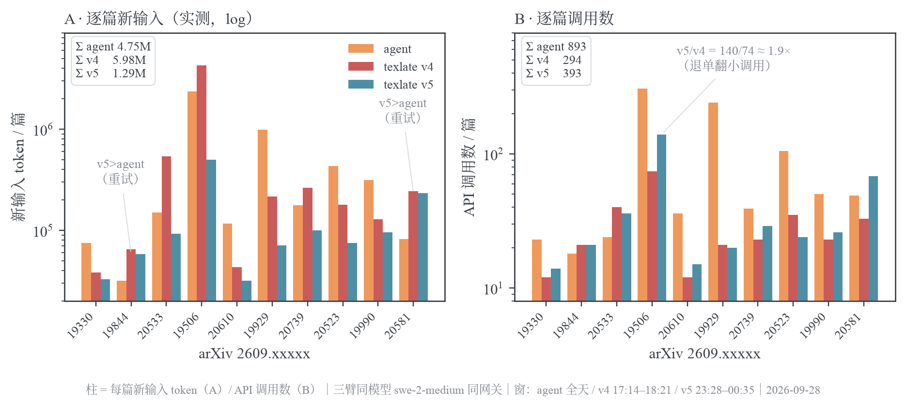
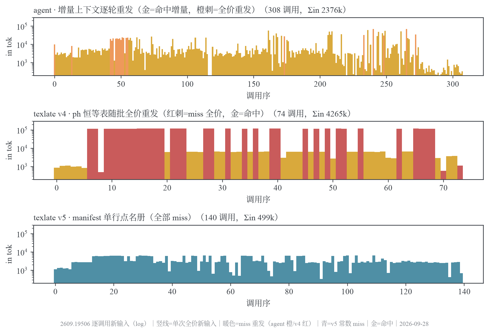
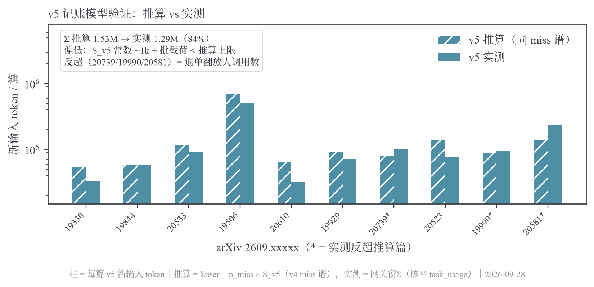
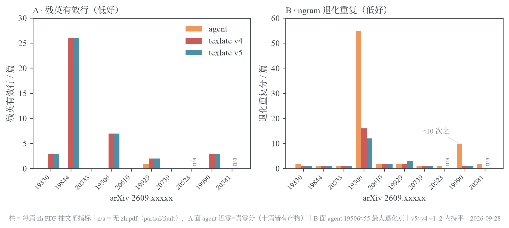

# 三臂翻译与 token 对照

这是 2026-09-28 至 10-02 的同十篇论文实验，模型为 `swe-2-medium`。agent 直翻、TeXlate prompt v4、v5、v6 是历史实验条件，不能当作现版本的性能承诺。

## 条件与读数

v4 与 agent 同日交错运行，v5 为后续深夜窗口，v6 于 10-02 复测。产品臂使用 `prefer=fresh`。网关按 API、凭据哈希和时间窗归属请求，并与任务用量核平；时间窗不是天然无歧义的任务标识。共享网关的调度和退化可能影响时长与重试。

| 指标           | agent      | v4        | v5        | v6        |
| -------------- | ---------: | --------: | --------: | --------: |
| 调用数         | 893        | 294       | 393       | 270       |
| 新输入 token   | 4,748,872  | 5,981,717 | 1,288,970 | 1,094,448 |
| 缓存读取 token | 50,121,590 | 3,769,664 | 29,334    | 1,536     |
| 输出 token     | 612,897    | 312,778   | 320,777   | 294,672   |

v4 的文档级占位符恒等表在每次请求中重发，长文单次新输入最高 121,926 token；v5 改为单行名单后，同篇峰值 6,553。v5 新输入是 v4 的 22%，但调用数增加；成员级重试集中于占位符密集段。v6 的名单、echo 容错和空白容错改动后，该样本的调用数下降 31%、新输入下降 15%。这组数据支持减少重复常数上下文，不单独证明某一条修改的因果效果。

v4/v5 的占位符 ID 存活检查十篇均为 100%，臆造 ID 为零，译文体量比 0.989–1.003；这只覆盖结构和所测规则。v4/v5/v6 的任务终态依次为 5/4/1、6/3/1、7/2/1（done/partial/fault），agent 均产出 PDF，但长文有重复退化。PDF 产出、任务终态和翻译质量需分别比较，不能据此宣称“质量零代价”。质量推断限制见[评测方法](../../2026-10-16-评测方法.md)。

## 数据与生成

- [baseline-tokens.json](baseline-tokens.json)：agent/v4 逐篇用量。
- [v5-ledger.json](v5-ledger.json)、[v5-arm-wins.json](v5-arm-wins.json)：v5 账本和请求窗口。
- [arms-ekg-rows.json](arms-ekg-rows.json)：逐请求曲线数据。
- [qc-results-v4-agent.json](qc-results-v4-agent.json)、[qc-results-v5.json](qc-results-v5.json)：规则质量检查快照。
- `make_arms_figs.py` 与 `_figstyle.py`：生成下方四张图。`make_arms_v5_projection_fig.py` 保存估算常数的推导，保留为来源；独立的重复投影 PNG 已删除，需要时可重新生成。推算不能替代实测。

## 图表

v6 原始窗口和用量只在原实验现场，未随包入库；上表保留历史汇总，不能承诺从本包完整复算 v6。原始文字版本可在重构前提交中查阅。后续更大样本见[token 实测](../token-economy/README.md)。
